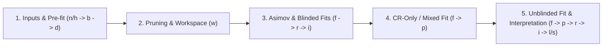

# TRExFitter: HistFactory Profile Likelihood Framework for HEP

`TRExFitter` ([`TRExStats/TRExFitter`](https://gitlab.cern.ch/TRExStats/TRExFitter)) is a C++ framework built on `ROOT`, `RooFit`, `RooStats`, `HistFactory`, and `xRooFit` for binned template profile likelihood fits in High Energy Physics (HEP). Originally developed in ATLAS as `TtHFitter`, it is used for signal strength ($\mu$) measurements, cross-section extractions, $\text{CL}_s$ exclusion limits, discovery significances, template morphing (e.g., top-quark mass $m_t$), and Profile Likelihood Unfolding (PLU).

## Skill Routing Map

When working on specific aspects of a `TRExFitter` analysis, load the corresponding specialized skill:

1. **`trex-config-and-inputs`**: Writing or validating `.config` files, `Job`/`Region`/`Sample`/`NormFactor`/`ShapeFactor` blocks, `ReadFrom: HIST` vs `NTUP` (including `FastFrames` integration), `AutoBin` (`TransfoD`, `TransfoF`, `TransfoJ`), blinding strategies, data-driven (`GHOST` / `NormalizedByTheory: FALSE`) backgrounds, `Expression` re-parameterizations, and `hupdate.exe`.
2. **`trex-systematics-and-gammas`**: Configuring `Systematic` blocks (`HISTO`, `OVERALL`, `SHAPE`), HistFactory modifiers (`OverallSys`, `HistoSys`, `ShapeSys`), symmetrisation (`ONESIDED`, `TWOSIDED`, `ABSMEAN`, `MAXIMUM`, `AlternativeShapeHistFactory`), smoothing (`MAXVARIATION`, `TTBARRESONANCE`, `COMMONTOOLSMOOTHMONOTONIC`, `COMMONTOOLSMOOTHPARABOLIC`, kernel options), pruning (`SystPruningShape`, `SystPruningNorm`, `SystLarge`, `PruningType`), two-point generator uncertainties (`ReferenceSample`, `SubtractRefSampleVar`), envelopes (`CombineName`/`CombineType`), decorrelation (`Decorrelate`, `DropNorm`, `DropShapeIn`), and MC statistical `gamma` parameters (`SeparateGammas`, `CorrelateGammasWithSample`, negative bin handling).
3. **`trex-fit-and-diagnostics`**: Running profile likelihood fits (`SPLUSB`, `BONLY`), Asimov and mixed fits, diagnosing HEP fit issues (Asimov unit-Hessian non-convergence, over-constraints $\Delta\hat{\theta} < 1$, under-constraints $>1$, spurious NP pulls, high correlations, non-smooth NLL scans), MINOS & 1D/2D likelihood scans, Saturated Model Goodness-of-Fit, NP Ranking (`r`), and Grouped Impact (`i`).
4. **`trex-unfolding-and-morphing`**: Profile Likelihood Unfolding (`FitType: UNFOLDING`, `Unfolding`, `TruthSample`, `UnfoldingSample`, `UnfoldingSystematic`, response/migration matrices, Tikhonov regularization `Tau`) and Template Morphing (`Morphing`, continuous POI interpolation `LINEAR`/`SMOOTHLINEAR`/`SQUAREROOT`, closure/linearity tests).
5. **`trex-limits-significance-multifit`**: $\text{CL}_s$ exclusion limits (`l` step, `ASYMPTOTIC` and `TOYS`, signal injection), discovery significance (`s` step), `MultiFit` (`m` step) workspace combinations and cross-fit comparisons, and publication outputs (`HEPDataFormat`, `UheppFormat`, `CombinerFormat`, `UseATLASRounding`).

Also consult [`references/histfactory_statistical_model.md`](references/histfactory_statistical_model.md) for the exact mathematical formulation of the HistFactory likelihood, interpolation schemes, and test statistics used by `TRExFitter`.

---

## 1. Environment Setup

`TRExFitter` can be run via CVMFS (`StatAnalysis`), container images (Apptainer/Singularity or Docker), or built from source with CMake.

### A. ATLAS CVMFS Environment (`StatAnalysis`)
On machines with `/cvmfs/atlas.cern.ch` mounted (e.g., `lxplus`):
```bash
setupATLAS
asetup StatAnalysis,0.8.0
# trex-fitter is immediately available on PATH
trex-fitter -h
```

### B. Apptainer / Singularity or Docker Container
Container images are published to `gitlab-registry.cern.ch/trexstats/trexfitter`:
```bash
# Apptainer / Singularity (e.g. on HPC or lxplus)
apptainer run --contain -B "${PWD}" --pwd "${PWD}" \
  docker://gitlab-registry.cern.ch/trexstats/trexfitter:latest

# Docker
docker run --rm -it -v "${PWD}:/work" -w /work \
  gitlab-registry.cern.ch/trexstats/trexfitter:latest
```

### C. Building from Source (with Submodules)
`TRExFitter` relies on submodules (`xroofit`, `SystematicSmoothingTool`, `UnfoldingCode`, `Blinder`, `yaml-cpp`):
```bash
git clone --recursive https://gitlab.cern.ch/TRExStats/TRExFitter.git
cd TRExFitter
source setup.sh
mkdir build && cd build
cmake ..
cmake --build . -j$(nproc)
```
The compiled executable is placed in `build/bin/trex-fitter` (and `build/bin/hupdate.exe`).

---

## 2. Command-Line Execution & Action Pipeline

The CLI syntax is:
```bash
trex-fitter <action(s)> <config_file> ["<option1>=<val1>:<option2>=<val2>"]
```
Multiple actions can be chained in a single invocation (e.g., `trex-fitter hwfcdp myFit.config`), though in production HEP analyses they are typically staged to inspect intermediate diagnostics and parallelize heavy steps.

### Complete Action Reference

| Action | Step Name | Description & Prerequisites |
| :---: | :--- | :--- |
| **`n`** | Read Ntuples | Reads ROOT `TTree` ntuples (`ReadFrom: NTUP`), applies `Selection` and `MCweight`, runs smoothing/symmetrisation, and writes histograms to `<JobName>/Histograms/`. |
| **`h`** | Read Histograms | Reads pre-produced ROOT histograms (`ReadFrom: HIST`, e.g., from `FastFrames`), applies smoothing/symmetrisation, and writes `<JobName>/Histograms/<JobName>*_histos.root`. |
| **`u`** | Unfolding Preparation | Folds `TruthSample` distributions with migration/response matrices, selection efficiencies, and acceptances (`FitType: UNFOLDING`) to prepare detector-level templates before `b`/`w`. |
| **`b`** | Re-bin & Smooth | Re-runs rebinning (`Rebinning`), systematic smoothing, symmetrisation, systematic combinations (`CombineName`), and `SeparateGammas` creation directly on existing `<JobName>/Histograms/` files without re-reading input ntuples/histograms. |
| **`w`** | Workspace Creation | Applies systematic pruning (`SystPruningShape`, `SystPruningNorm`, `SystLarge`), writes pruning plots (`Pruning.pdf`), constructs HistFactory XMLs (`RooStats/*.xml`), and builds the `RooWorkspace` (`RooStats/<JobName>_combined_<JobName>_model.root`). |
| **`d`** | Pre-Fit Plots | Draws pre-fit Data/MC comparison stack plots (`Plots/`), summary plots, signal region $S/B$ plots, background composition pie charts, pre-fit yield tables (`Tables/`), and systematic control plots (`Systematics/`). Requires `h`/`n` (and `w` if using workspace-based `xRooFit` plotting). |
| **`f`** | Profile Likelihood Fit | Minimizes $-\ln\mathcal{L}$ using `Minuit2`/`xRooFit` on the workspace from `w`. Writes best-fit NPs, pulls, constraints, covariance/correlation matrices (`Fits/<JobName>.txt`, `Fits/<JobName>.root`, `CorrMatrix.pdf`, `NuisPar.pdf`), Goodness-of-Fit, and likelihood scans (`LHoodPlots/`). |
| **`p`** | Post-Fit Plots | Propagates best-fit POIs, NP pulls, constraints, and full post-fit covariance matrix (`Fits/<JobName>.root`) to produce post-fit Data/MC plots (`Plots/*_postFit.*`) and post-fit yield tables (`Tables/*_postFit.*`). |
| **`r`** | NP Ranking | Evaluates the pre-fit and post-fit impact ($\Delta\hat{\mu}$) of each nuisance parameter on the POI(s) and draws the ranking ("brazil/bar") plot (`Ranking.pdf`). Can be parallelized with `Ranking=<NP_name_or_index>` followed by `Ranking=plot`. |
| **`i`** | Grouped Impact | Evaluates the quadrature-subtracted uncertainty breakdown on the POI(s) by fixing groups of NPs (`SubCategory`) to their best-fit values. Can be parallelized with `GroupedImpact=<SubCategory>` followed by `GroupedImpact=combine`. |
| **`l`** | Exclusion Limits | Computes 95% $\text{CL}_s$ upper limits (`Limits/`) using `ASYMPTOTIC` formulas or `TOYS` via `xRooFit`. |
| **`s`** | Significance | Computes discovery $p_0$-value and significance $Z$ (`Significance/`) under the background-only hypothesis ($\mu=0$). |
| **`m`** | Multi-Fit | Combines or compares multiple `TRExFitter` configurations (`multiFitSchema.config`). Supports combined fits, limits, significances, pull/POI comparisons, and 2D scans. |
| **`x`** | Likelihood Scan Only | Runs only the 1D or 2D profile likelihood scan (`doLHscan` / `do2DLHscan`) without repeating standard pull/correlation outputs (ideal for batch parallelization via `LHscan=<param>` or `Parallel2DscanStep=<idx>`). |
| **`a`** | Separation Plots | Produces normalized signal vs. background shape separation plots (`SeparationPlot`). |

### Key Command-Line Override Options (`"<key>=<value>:..."`)

Options are colon-separated `Key=Value` pairs passed as a single quoted string:
- `Regions=SR1,CR_ttbar` / `Samples=ttH,ttbar` / `Systematics=JES*,bTag*` / `Exclude=VR*`: Filter active blocks (supports `*` wildcards).
- `Signal=SignalSampleName`: Select active signal sample when multiple `SIGNAL` samples exist.
- `FitType=SPLUSB|BONLY|UNFOLDING`, `FitRegion=CRSR|CRONLY`, `FitBlind=TRUE|FALSE`: Override `Fit` block settings on the fly.
- `StatOnly=TRUE` (ignores all systs & gammas; requires re-running `w`) vs `StatOnlyFit=TRUE` (fixes all NPs and gammas at their best-fit values during `f` to extract pure data statistical uncertainty).
- `Ranking=<NP_name|index|plot>`: Run single-NP ranking fit in batch or plot combined ranking.
- `GroupedImpact=<group_name|combine>`: Run single-group impact fit in batch or combine results.
- `LHscan=<NP_or_POI>`: Run 1D likelihood scan for a specific parameter (used with `x` or `f`).
- `Parallel2Dscan=TRUE:Parallel2DscanStep=<0..N-1>`: Run a single X-slice of a 2D likelihood scan.
- `Update=TRUE`, `SaveSuffix=_syst1`, `Suffix=_test`: Control histogram file updating and output naming.
- `Job=NewJobName`: Override the `Job` name/output directory from the command line.
- `BootstrapIdx=0`: Run or fit the $i$-th bootstrap replica.

---

## 3. Standard HEP Analysis Workflow & Directory Layout

A well-structured `TRExFitter` workflow proceeds through 5 stages matching ATLAS internal review milestones (unblinding checklist):



### Output Directory Structure (`<OutputDir>/<JobName>/`)
- `Histograms/`: Root files containing nominal and systematic templates (`<JobName>_<Region>_histos.root` if `SplitHistoFiles: TRUE`, stored internally under `<Region>/<Sample>/<Systematic>` folders when `UseFolderStructure: TRUE`).
- `Systematics/`: Pre- and post-smoothing/symmetrisation control plots (`SystControlPlots: TRUE`, `SystDataPlots: TRUE`)—**always inspect these first when debugging a fit**.
- `RooStats/`: HistFactory XML definitions (`*.xml`), `HistFactorySchema.dtd`, and the compiled `RooWorkspace` ROOT file (`*_combined_*_model.root`).
- `Fits/`: Fit result text files (`<JobName>.txt`, `<JobName>_statOnly.txt`), `RooFitResult` ROOT files (`<JobName>.root`), `NPRanking*.txt`, and `GroupedImpact*.txt`.
- `Plots/`: Pre-fit and post-fit stacked histograms (`*_preFit.pdf`, `*_postFit.pdf`), `Summary_*.pdf`, `SignalRegions*.pdf`, `PieChart*.pdf`.
- `Tables/`: Yield and systematic breakdown tables in `.txt` and LaTeX `.tex` formats.
- `LHoodPlots/`: 1D (`NLLscan_*.pdf`) and 2D (`NLLscan2D_*.pdf`) profile likelihood curves.
- `Limits/` & `Significance/`: Asymptotic or toy-based $\text{CL}_s$ limit and discovery significance ROOT/plot outputs.
- `Unfolding/` & `Morphing/`: Unfolded truth distributions, response/migration plots, and bin-by-bin morphing interpolation plots.
